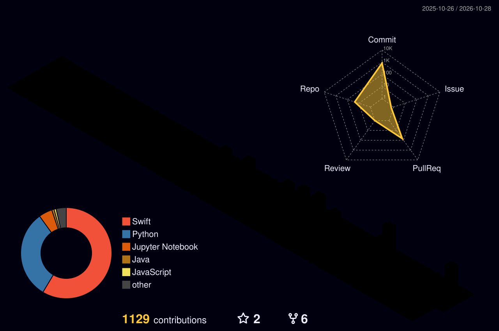

<div align="center">


<br/>

[](https://github.com/EnzoFerroni)
[](https://linkedin.com/in/enzoferroni)


</div>

---

## 👨‍💻 Who am I?

```swift
let enzo = Developer(
    name:      "Enzo Ferroni",
    education: "Information Systems & Data Science @ Mackenzie",
    community: "Apple Developer Academy",
    focus:     ["iOS", "Swift", "AI/ML"],
    languages: ["Portuguese", "English"],
    graduates: 2026,
    openTo:    ["Junior", "Trainee", "Internship"],
    currently: "Building cool apps for iOS"
)
```

---

## 📱 Apps on the App Store

<div align="center">
<table>
<tr>
<td align="center" width="33%">
<a href="https://apps.apple.com/br/app/gamesource/id6749157683"></a>
<br/><b><a href="https://github.com/EnzoFerroni/GameSource">GameSource</a></b>
<br/><sub>Your Steam library and achievements</sub>
</td>
<td align="center" width="33%">
<a href="https://apps.apple.com/br/app/mimi-dreams/id6747144355"></a>
<br/><b><a href="https://github.com/EnzoFerroni/MimiDreams">MimiDreams</a></b>
<br/><sub>Dream journal with a pixel companion</sub>
</td>
<td align="center" width="33%">
<a href="https://apps.apple.com/br/app/notadiary/id6753695305"></a>
<br/><b><a href="https://github.com/EnzoFerroni/NotADiary">NotADiary</a></b>
<br/><sub>Emotional journal with haptics and music</sub>
</td>
</tr>
<tr>
<td align="center" width="33%">
<a href="https://apps.apple.com/br/app/zelu/id6772319658"></a>
<br/><b><a href="https://github.com/C13G1/Zelu">Zelu</a></b>
<br/><sub>Keep your friendships alive</sub>
</td>
<td align="center" width="33%">
<a href="https://apps.apple.com/br/app/vivacidade/id6761855371"></a>
<br/><b><a href="https://github.com/C12G4/ProjectCidadeParaPessoas">Vivacidade</a></b>
<br/><sub>Rediscover the city around you</sub>
</td>
</tr>
</table>
</div>

---

## ✨ Highlights

- 💛 **[Zelu](https://github.com/C13G1/Zelu)**: SwiftUI + SpriteKit app to keep friendships alive, published on the App Store under my name
- 👻 **[Causos Ocultos Quixeramobim](https://github.com/C11G3/CausosOcultosQuixeramobim)**: SpriteKit game for iPhone and Apple Watch inspired by the local stories of Quixeramobim
- 🗓️ **[Alinha](https://github.com/EnzoFerroni/AlinhaProject)**: mentorship queue system for iOS, macOS and tvOS with a Vapor backend, built by a ~30-person team at the Apple Developer Academy
- 🔬 **[iOS reverse engineering research](https://github.com/EnzoFerroni/ios-reverse-engineering-lab)**: PIBIC Mackenzie undergraduate research (2026) with Ghidra, radare2 and Frida
- 🧠 **On-device AI**: [SwiftExpressions](https://github.com/EnzoFerroni/SwiftExpressions) (Core ML + Vision) and [Diario](https://github.com/EnzoFerroni/Diario) (Apple Intelligence Foundation Models)
- 🥽 **visionOS**: [SweetShapery](https://github.com/EnzoFerroni/SweetShapery), an immersive RealityKit app
- 🌬️ **[Exalo](https://github.com/EnzoFerroni/Exalo)**: my Swift Student Challenge 2026 submission

---

## 🛠️ Tech Stack

<div align="center">

**Mobile**

<a href="https://www.swift.org" title="Swift"></a>

**Apple Frameworks**


**Frontend**

<a href="https://developer.mozilla.org/docs/Web/HTML" title="HTML"></a>
<a href="https://developer.mozilla.org/docs/Web/CSS" title="CSS"></a>
<a href="https://developer.mozilla.org/docs/Web/JavaScript" title="JavaScript"></a>
<a href="https://www.typescriptlang.org" title="TypeScript"></a>
<a href="https://react.dev" title="React"></a>
<a href="https://nextjs.org" title="Next.js"></a>
<a href="https://tailwindcss.com" title="Tailwind CSS"></a>
<a href="https://getbootstrap.com" title="Bootstrap"></a>
<a href="https://vitejs.dev" title="Vite"></a>

**Backend**

<a href="https://dev.java" title="Java"></a>
<a href="https://nodejs.org" title="Node.js"></a>
<a href="https://www.djangoproject.com" title="Django"></a>
<a href="https://spring.io" title="Spring"></a>
<a href="https://maven.apache.org" title="Maven"></a>

**Databases**

<a href="https://www.mysql.com" title="MySQL"></a>
<a href="https://www.postgresql.org" title="PostgreSQL"></a>
<a href="https://www.sqlite.org" title="SQLite"></a>
<a href="https://www.mongodb.com" title="MongoDB"></a>
<a href="https://supabase.com" title="Supabase"></a>

**Cloud & DevOps**

<a href="https://aws.amazon.com" title="AWS"></a>
<a href="https://cloud.google.com" title="Google Cloud"></a>
<a href="https://azure.microsoft.com" title="Azure"></a>
<a href="https://www.docker.com" title="Docker"></a>
<a href="https://vercel.com" title="Vercel"></a>
<a href="https://grafana.com" title="Grafana"></a>

**Data & AI**

<a href="https://www.python.org" title="Python"></a>
<a href="https://www.anaconda.com" title="Anaconda"></a>
<a href="https://www.r-project.org" title="R"></a>

**Editors & Version Control**

<a href="https://code.visualstudio.com" title="VS Code"></a>
<a href="https://git-scm.com" title="Git"></a>
<a href="https://github.com" title="GitHub"></a>

**Shell & Operating Systems**

<a href="https://www.gnu.org/software/bash/" title="Bash"></a>
<a href="https://learn.microsoft.com/powershell/" title="PowerShell"></a>
<a href="https://www.kernel.org" title="Linux"></a>
<a href="https://www.microsoft.com/windows" title="Windows"></a>
<a href="https://developer.apple.com" title="Apple"></a>

**Design & Testing**

<a href="https://www.figma.com" title="Figma"></a>
<a href="https://www.postman.com" title="Postman"></a>

**Community & Docs**

<a href="https://discord.com" title="Discord"></a>
<a href="https://www.linkedin.com/in/enzoferroni/" title="LinkedIn — Enzo Ferroni"></a>
<a href="https://www.markdownguide.org" title="Markdown"></a>
<a href="https://stackoverflow.com" title="Stack Overflow"></a>

</div>

---

## 📊 Contributions

<div align="center">




</div>

---

## 📫 Contact

<div align="center">

[](https://linkedin.com/in/enzoferroni)
[](mailto:enzoferroni@hotmail.com)

Open to **junior**, **trainee** and **internship** roles in iOS development.

</div>
